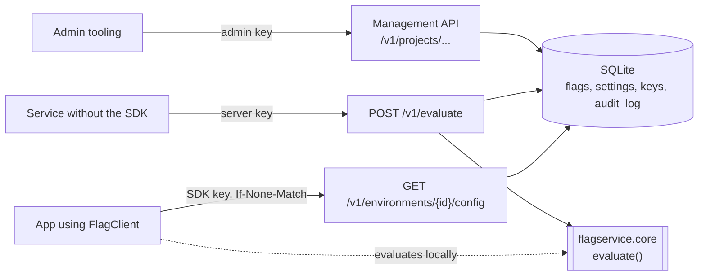

# feature-flag-service

A small, self-hostable feature-flag service. An HTTP API (FastAPI, SQLite)
defines projects, environments and flags with ordered targeting rules and
percentage rollouts; backends ask it to evaluate a flag, or use the Python SDK,
which downloads an environment's ruleset, keeps it fresh by polling with ETags,
and evaluates locally with the same code the server runs. Flag changes use
optimistic concurrency, every change lands in an audit log in the same
transaction, and percentage rollouts are deterministic and tested for stability
and distribution.

## Quick start

Requires Python 3.11 or newer. From a clone of this repository:

```bash
python -m venv .venv && . .venv/bin/activate
pip install .
export FLAGS_ADMIN_KEY="$(python -c 'import secrets; print(secrets.token_urlsafe(32))')"
flagservice-server &   # 127.0.0.1:8000; interactive API docs at /docs
sleep 2
```

Create a project, an environment and a flag that is on for 25% of users, and an
SDK key for that environment:

```bash
A="Authorization: Bearer $FLAGS_ADMIN_KEY"; J="Content-Type: application/json"
curl -fsS -o /dev/null -X POST 127.0.0.1:8000/v1/projects -H "$A" -H "$J" \
  -d '{"key": "shop", "name": "Shop"}'
curl -fsS -o /dev/null -X POST 127.0.0.1:8000/v1/projects/shop/environments -H "$A" -H "$J" \
  -d '{"key": "production", "name": "Production"}'
curl -fsS -o /dev/null -X POST 127.0.0.1:8000/v1/projects/shop/flags -H "$A" -H "$J" -d '{
  "key": "new-checkout", "type": "boolean",
  "environments": {"production": {"enabled": true, "default_variant": "off",
    "rules": [{"split": [{"variant": "on", "weight": 25}, {"variant": "off", "weight": 75}]}]}}}'
export FLAGS_SDK_KEY="$(curl -fsS -X POST 127.0.0.1:8000/v1/projects/shop/environments/production/keys \
  -H "$A" -H "$J" -d '{"kind": "sdk"}' | python -c 'import json, sys; print(json.load(sys.stdin)["token"])')"
```

Evaluate it in-process with the SDK:

```bash
python - <<'EOF'
import os

from flagservice.sdk import FlagClient

with FlagClient("http://127.0.0.1:8000", os.environ["FLAGS_SDK_KEY"], poll_interval=30) as flags:
    flags.wait_until_ready(timeout=5)
    users = [f"user-{i}" for i in range(1000)]
    enabled = sum(flags.bool_value("new-checkout", {"key": user}, False) for user in users)
    print(f"new-checkout is on for {enabled} of {len(users)} users")
    print(flags.evaluate("new-checkout", {"key": "user-1"}))
EOF
```

One run printed:

```
new-checkout is on for 263 of 1000 users
EvaluationResult(variant='off', value=False, reason=<Reason.SPLIT: 'SPLIT'>, rule_index=0, error=None)
```

The numbers change from run to run, because each new flag gets a random salt
and so a different 25% of users. Stop the server with `kill %1`.
[`examples/walkthrough.md`](examples/walkthrough.md) goes through the rest of
the API with curl (targeting rules, server-side evaluation, ETag conflicts,
key scopes, the audit log) and shows the real responses.

Configuration is two environment variables: `FLAGS_ADMIN_KEY` (required, at
least 32 characters) and `FLAGS_DATABASE` (the SQLite file, default
`flags.db`). `flagservice-server` takes `--host` and `--port`. To run it in a
container (the image runs as an unprivileged user and keeps the database in
`/data`):

```bash
docker build -t feature-flag-service .
docker run -p 8000:8000 -e FLAGS_ADMIN_KEY -v flags-data:/data feature-flag-service
```

## Design



The code is in three parts that depend only downwards:

| package              | what it holds                                                                 |
|----------------------|-------------------------------------------------------------------------------|
| `flagservice.core`   | The flag schema (Pydantic), the evaluator, bucketing, SemVer and write-time validation. Pure: no I/O, no state. |
| `flagservice.server` | FastAPI app: routes, credentials, ETags, the SQL store and the migration runner. |
| `flagservice.sdk`    | `FlagClient`: background polling and typed getters over `core.evaluate`.      |

**Data model.** A project has environments and flags. A flag has a key, a type
(`boolean`, `string`, `number`, `json`), variants (a key and a value of that
type), a random salt and a version, and for each environment of its project a
settings row: an on/off switch, a default variant and an ordered list of rules.
All conditions of a rule have to hold, and the rule serves one variant or a
weighted split. Variants and rules are stored as JSON documents; everything the
server looks rows up by is a column.

**Evaluation.** A switched-off flag gives `DISABLED` and no value (the caller's
default applies). Otherwise the first rule whose conditions all match decides
(`TARGETING_MATCH`, or `SPLIT` for a percentage split), and if none does the
default variant is served (`DEFAULT`). A missing flag is `FLAG_NOT_FOUND`;
anything unreadable is `ERROR`. Splits bucket a context with
`SHA-256(flag_key:salt:value)`, the first 8 bytes taken modulo 10,000, and
give each variant a consecutive range of buckets, one per 0.01%. The full
semantics, operator by operator, are in [docs/evaluation.md](docs/evaluation.md).

**Request path.** Each request opens its own SQLite connection (WAL mode).
Writes run in `BEGIN IMMEDIATE` transactions, which take SQLite's write lock
before reading, so "compare the ETag, write, bump the version, append the audit
entry" is atomic. Reads that assemble a flag or a config from several queries
run in a read transaction, which gives them one snapshot. The API reference,
including status codes and the order in which requests are checked, is in
[docs/api.md](docs/api.md).

**SDK.** `FlagClient(base_url, sdk_key, poll_interval)` reads its environment id
from the key, fetches the config on a background thread, and then sends
`If-None-Match` so that unchanged polls cost a 304 with no body. A failed fetch
(network error, timeout, 5xx, 401, unreadable body) keeps the last good config.
The getters take `(flag_key, context, default)` and return the default for
missing, disabled, wrongly typed or failing flags; they never raise.

## Decisions and trade-offs

* **One evaluator, two callers.** The server and the SDK call the same pure
  function, so their logic cannot drift apart. Their inputs still travel
  different paths (the server builds a flag from database rows, the SDK from
  published JSON), which is why a test compares them on thousands of random
  contexts.
* **Polling with ETags rather than streaming.** Plain HTTP works through any
  proxy and needs no connection state on the server, and a 304 is cheap. The
  cost is staleness: a change reaches SDKs within one `poll_interval`.
* **SQLite with explicit SQL.** One file, no ORM, a schema you can read in
  `src/flagservice/server/migrations/0001_initial.sql`. Writers are serialised,
  which suits a configuration store that people edit rather than one that takes
  a stream of writes. It also limits the service to one host (see Limitations).
* **Migrations as numbered SQL files.** Applied at start-up in order, each in
  its own transaction, statement by statement (`executescript` would commit
  half of a failed migration). Each is recorded with a checksum: the server
  refuses to start if an applied migration file was edited or if the database
  has a migration the code does not know.
* **One version per flag, and If-Match required.** Simpler for clients than a
  version per environment, at the price of a false conflict when two people
  edit different environments of one flag at the same moment. A missing
  `If-Match` is a 428 and `If-Match: *` is refused, so every write states which
  version it was based on. The ETag includes the flag's id, which is never
  reused, so a recreated flag does not accept its predecessor's ETags.
* **The config ETag is a hash of the body.** The body is serialised
  deterministically, so the ETag changes exactly when the content does and
  there is no cache-invalidation bookkeeping. The server still builds the
  config to answer a 304, which is fine at this size.
* **Disabled means "use your default".** There is no separate "off variant": a
  switched-off flag returns no value and the application's own default applies.
  To serve one value to everyone, leave the flag on with no rules.
* **Missing attributes never match, comparisons are type-strict.** `neq` and
  `not_in` do not match a context that lacks the attribute, and `"1"`, `1` and
  `true` are three different values. A split rule whose bucketing attribute is
  missing is skipped rather than putting the context in bucket 0, so anonymous
  traffic does not join a rollout by accident.
* **Weights in hundredths of a percent.** With 10,000 buckets every allowed
  weight is an exact number of buckets, and the sum is checked in integers.
* **API keys are random tokens stored as SHA-256 hashes.** A slow password hash
  protects guessable secrets; these are 256 random bits, so a fast hash is
  enough. Comparison uses `hmac.compare_digest`. The token carries its
  environment id, so the SDK needs nothing but the key, and its key id, so the
  server finds the record without scanning and the audit log can name it.
* **Full snapshots in the audit log.** Each entry stores the whole resource
  before and after, which makes entries self-contained and easy to diff, at the
  cost of storage that grows with flag size. The entry is written in the same
  transaction as the change, so neither exists without the other. Pages are
  cut by id with an opaque cursor, so they stay stable while entries arrive.
* **Validation in two layers.** Pydantic models check structure (and are shared
  with the SDK, which parses the config with them); checks that need the whole
  flag, such as "this rule serves a variant that exists", run on every write.
  The evaluator trusts neither and reports `ERROR` on a bad config. The SDK
  parses flags one by one, so a flag written by a newer server version breaks
  only that flag.

## How correctness is tested

`pytest` runs the suite with no network; the HTTP tests use FastAPI's
`TestClient` on a temporary SQLite file per test. Property tests use Hypothesis
with a fixed seed, so every run checks the same examples.

* **Bucketing** (`tests/test_bucketing.py`): the implementation matches the
  documented formula on generated inputs and on pinned reference vectors; the
  same context gets the same variant regardless of key order or unrelated
  attributes; raising a rollout never drops anyone who was in, for generated
  users and pairs of percentages; a split's counts match its weights by a
  chi-square test (p > 0.001) on 50,000 generated keys for five weightings and
  three seeds; buckets are uniform across 100 bins; two flags with different
  salts bucket independently. The chi-square p-value comes from closed forms in
  `tests/helpers.py`, which are checked against table values.
* **Evaluation** (`tests/test_evaluate.py`, `tests/test_semver.py`): every
  operator, including type strictness, missing attributes and NaN; rule order;
  every reason; the schema's error messages; SemVer precedence against the
  specification's example and as a total order on generated versions.
* **Server and SDK agree** (`tests/test_agreement.py`): twelve flags with random
  types, conditions and splits are created through the API, then 3,000 random
  contexts (with missing attributes and wrongly typed values) are evaluated by
  the SDK from the published config and by the server's evaluation function with
  JSON-encoded requests; 300 of them also go through `POST /v1/evaluate`. Every
  result must match, and the sample must produce every reason except `ERROR`.
* **Concurrency** (`tests/test_concurrency.py`): threads released together by a
  barrier update a flag with the same ETag, through the store with separate
  connections and through HTTP; exactly one succeeds and the others get 412.
* **API** (`tests/test_api_*.py`, `tests/test_runtime.py`, `tests/test_audit.py`):
  CRUD, the validation rules of `docs/api.md` (through the API, or on the models
  the API uses), 412 and 428, `If-None-Match` and 304, the audit log's contents
  and pagination, and that a change whose audit write fails is rolled back.
* **Key scope** (`tests/test_auth.py`): every key kind against every kind of
  endpoint (an SDK key cannot write), missing, tampered and revoked tokens, and
  that only hashes reach the database.
* **Migrations** (`tests/test_migrations.py`): from an empty database,
  idempotent, ordered, a failing migration leaves nothing behind, edited and
  unknown migrations are refused, and four concurrent start-ups apply each
  migration once. That last test found a real race: switching to WAL mode
  reports "database is locked" without waiting for the busy timeout, so the
  switch now retries.
* **SDK** (`tests/test_sdk.py`): against a scripted server, the ETag round trip,
  keeping the last good config through six kinds of failure, defaults before
  the first load, type checks in the getters, copies of JSON values, and the
  polling and shutdown of the background thread.

`examples/rollout_distribution.py` puts numbers on the bucketing for a fixed
population. Its output:

```
$ python examples/rollout_distribution.py
Split 10/30/60 over 100,000 users (salt 0123456789abcdef):
  a:  9,956 observed,   10,000 expected
  b: 30,106 observed,   30,000 expected
  c: 59,938 observed,   60,000 expected
  chi-square = 0.632 (2 degrees of freedom), p = 0.729
Raising a rollout from 10% to 20%:
  on at 10%: 9,956; on at 20%: 19,903
  on at 10% but not at 20%: 0
  newly on at 20%: 9,947
```

## Limitations

These are deliberate omissions:

* **One host.** SQLite serialises writers and the service has no replication or
  failover. Server processes on one host can share the database file; servers
  on different hosts cannot.
* **No streaming.** SDKs learn about changes on their next poll.
* **One admin key, no users or roles.** Every management change is attributed
  to `admin`, and there are no per-project permissions. Server and SDK keys can
  be created and revoked but do not expire.
* **Flat contexts and a fixed operator set.** Attributes are scalars (no lists
  or nested objects); there are no regular expressions, reusable segments,
  prerequisite flags or scheduled changes, and string comparisons do not
  normalise case or Unicode.
* **One flag per evaluation request.** `POST /v1/evaluate` has no bulk form.
* **No evaluation analytics.** Nothing records which users saw which variant.
* **The audit log is per project.** After a project is deleted its entries stay
  in the database but are no longer reachable through the API.
* **A flag's key and type are fixed**; create a new flag to change them.
* **Python SDK only**, synchronous (a background thread), with no asyncio client.
* **Edge concerns are left to a reverse proxy**: TLS, rate limiting and request
  size limits.

## Development

```bash
uv venv && uv pip install -e ".[dev]"   # or: python -m venv .venv && pip install -e ".[dev]"
ruff check .
ruff format --check .
mypy
pytest
```

CI (`.github/workflows/ci.yml`) runs the same four commands on Python 3.11, 3.12
and 3.13. `examples/walkthrough.sh` replays the curl walkthrough against a
running server.

## License

MIT, see [LICENSE](LICENSE).
